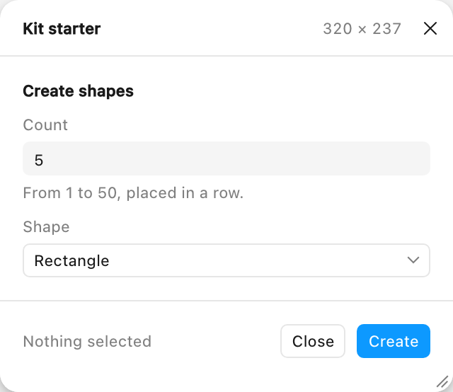
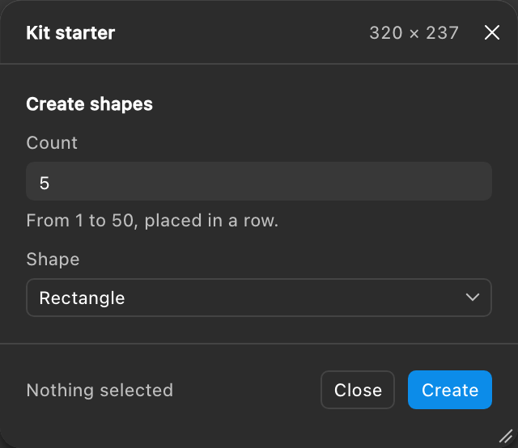

**Is this for you?** Quick internal tool: use Figma's agent. Network access, monetization, FigJam, Dev Mode or full UI control: start here.

# Figplug UI Kit

Starter files for Figma classic plugins with native-looking UI and a resizable window, made to be built on with Claude Code or Cursor. Not [rsms/figplug](https://github.com/rsms/figplug) (the plugin build tool). Fallback name: TBD.

| Light | Dark |
|---|---|
|  |  |

_Rendered by the browser preview (`npm run preview`): a stand-in window frame and the fallback palette, not Figma itself. A side-by-side with Figma's own panel is pending a capture in the real Figma app ([steps](docs/release-checklist.md#a-side-by-side-with-figmas-own-panel-item-4))._

Three hand-editable files and nothing to install: `manifest.json`, `code.ts` (compiled `code.js` included) and `ui.html`. Colours are Figma's own `--figma-color-*` tokens, so the UI follows light, dark and FigJam; controls are 24px like Figma's panels; the window fits its content, resizes from a corner grip and remembers the width. [`AGENTS.md`](AGENTS.md) tells your agent the rules, and `npm run audit` checks what it wrote.

## 60-second start

1. **Code > Download ZIP** on this page and unzip it (or `git clone https://github.com/alekseikipin/Figplug-ui-kit.git`).
2. In the **Figma desktop app**, open any file, then Figma menu > **Plugins > Development > Import plugin from manifest...** and pick `manifest.json`.
3. Run **Plugins > Development > Kit starter**.

No terminal, no build. If nothing happens or macOS asks about Documents, see the [import gotchas](docs/install.md#import-gotchas).

## The one prompt

Give Claude Code or Cursor this, with `<task>` filled in:

```text
Clone https://github.com/alekseikipin/Figplug-ui-kit, read AGENTS.md, build a plugin that <task> with kit classes only, then tell me how to import it.
```

For example, `<task>` = "exports the selected layers as PNG at 1x, 2x or 3x and downloads the files". Five pinned tasks and the one-shot log are in [docs/prompts.md](docs/prompts.md).

## Your loop

- **Changed `ui.html`?** No build: rerun the plugin with **Cmd+Opt+P** (Ctrl+Alt+P).
- **Changed `code.ts`?** `npm run build` (or `npm run watch`), then rerun. A watch task started in VS Code stops when you reopen VS Code: start it again (Terminal > Run Build Task..., or `npm run watch`).
- **Then check:** `npm run audit && npm run check:ui`. Your agent runs these for you.
- **Errors:** Plugins > Development > Show/Hide console.
- **Import gotchas:** the macOS Documents permission prompt, a file picker that does nothing, the Widgets menu's look-alike import item, and the example `id` that every copy shares until you change it. All in [docs/install.md](docs/install.md#import-gotchas); the loop in full is [docs/loop.md](docs/loop.md).

## Limits, plainly

- **Dropdowns are the native `<select>`.** The open list is your operating system's popup, not Figma's dark menu.
- **FigJam is light only**, with a purple brand colour; FigJam has no dark mode.
- **Slides has no variables** (nor components or styles), so plugins built on them don't work there.
- **Inter, or system-ui.** The kit names Inter first and loads no font; where the plugin window lacks Inter, text falls back to the system font. To embed Inter yourself, see "Opt-in Inter" under [Kit tokens](docs/tokens.md#kit-tokens).
- Dev Mode needs a second manifest, and Dev Mode and Buzz dock the plugin in a panel with no resize grip ([docs/surfaces.md](docs/surfaces.md)). What has not been measured in a real Figma client yet is marked UNVERIFIED in the docs.

## Docs

[Install](docs/install.md) · [Your loop](docs/loop.md) · [Prompts](docs/prompts.md) · [Components](docs/components.md) · [Tokens](docs/tokens.md) · [Window chrome](docs/window-chrome.md) · [Messages](docs/messages.md) · [Surfaces](docs/surfaces.md) · [Pitfalls](docs/pitfalls.md) · [Accessibility](docs/accessibility.md) · [All docs](docs/index.md) · [Changelog](CHANGELOG.md)

Official Figma docs: [plugin quickstart](https://developers.figma.com/docs/plugins/plugin-quickstart-guide/), [CSS variables](https://developers.figma.com/docs/plugins/css-variables/).

Bugs and questions: [issues](https://github.com/alekseikipin/Figplug-ui-kit/issues). MIT licence ([LICENSE](LICENSE)).
