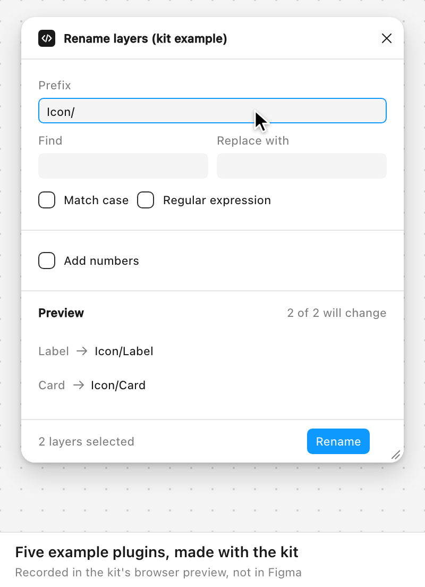

<div align="center">

# Figplug UI Kit

**Make Figma plugins that look like Figma. Describe your plugin, and an AI agent builds it.**<br>
Free starter code for Figma plugins (not a design file), with 20 ready-made interface parts. It runs in the Figma desktop app with no setup.

**[See every part live in your browser →](https://alekseikipin.github.io/Figplug-ui-kit/)**

[](https://github.com/alekseikipin/Figplug-ui-kit/actions/workflows/ci.yml) [](LICENSE) [](CHANGELOG.md)

<picture>
  <source media="(prefers-color-scheme: dark)" srcset="docs/media/hero-dark.gif">
  
</picture>

</div>

## Try it

You only need the **Figma desktop app**.

1. Click **Code → Download ZIP** at the top of this page, then unzip it.
2. In Figma, open any file and choose **Plugins → Development → Import plugin from manifest…**. Pick `manifest.json` in the unzipped folder.
3. Run **Plugins → Development → Kit starter**. Choose a number, press **Create**, and drag the window's corner.

<details>
<summary>Import not working?</summary>

- **macOS asks for access to Documents** (or Desktop, Downloads): allow it, or Figma can't read the folder.
- **Nothing happens after you choose Import plugin from manifest**: use the Figma menu with a file open, not the right-click menu on the canvas. Restart Figma if it still does nothing.
- **Use the Plugins menu, not Widgets.** The Widgets menu has a similar item.

More fixes: [docs/install.md](docs/install.md#import-gotchas).

</details>

## Build your own plugin with an AI agent

Paste this prompt into an AI agent that can work with files on your computer (a regular chat can't). Replace `<task>` with one sentence about your plugin:

```text
Clone https://github.com/alekseikipin/Figplug-ui-kit, read AGENTS.md,
build a plugin that <task> with kit classes only,
then tell me how to import it.
```

For example: *"renames the selected layers with a prefix and shows a preview of the new names before I apply them"*.

The agent downloads its own copy of the kit, builds the plugin, checks its work and tells you how to open it in Figma. Want a change? Ask the agent, then rerun the plugin in Figma with **Cmd+Opt+P** (Ctrl+Alt+P on Windows).

Your computer also needs [Node.js](https://nodejs.org/) 24 or later: the agent uses it to build and check the plugin. The finished plugin runs without it.

<details>
<summary>See the agent at work</summary>

<picture>
  <source media="(max-width: 600px) and (prefers-color-scheme: dark)" srcset="docs/media/agent-narrow.svg#dark">
  <source media="(max-width: 600px)" srcset="docs/media/agent-narrow.svg#light">
  <source media="(prefers-color-scheme: dark)" srcset="docs/media/agent.svg#dark">
  
</picture>

This animation is a mock-up of a typical run. More prompts and real test results: [docs/prompts.md](docs/prompts.md).

</details>

## What's inside

- Uses Figma's colours, so it matches light mode, dark mode and FigJam.
- 20 ready-made parts: buttons, text fields, menus, dialogs, notifications and more.
- A window that resizes to fit its content. People can drag its corner, and the plugin remembers the size.
- Six example plugins to learn from or start with.
- Checks that catch common mistakes in the agent's work before you open the plugin in Figma.

<p align="center">
<picture>
  <source media="(prefers-color-scheme: dark)" srcset="docs/img/figma-side-by-side-dark.png">
  
</picture>
<br><sub>The starter plugin (left) next to Figma's own Design panel, in the Figma desktop app.</sub>
</p>

<details>
<summary>All 20 parts</summary>

<picture>
  <source media="(prefers-color-scheme: dark)" srcset="docs/media/components-sheet-dark.png">
  
</picture>

| Group | Parts |
|---|---|
| Actions | button, icon button |
| Fields | text input, text area, number field, colour field |
| Choices | select, checkbox, radio button, tabs |
| Pop-ups | tooltip, menu, dialog, notification (toast) |
| Layout | list, empty state, notice, section header, footer, resize corner |

<picture>
  <source media="(prefers-color-scheme: dark)" srcset="docs/media/components-dark.gif">
  
</picture>

The code for each part: [docs/components.md](docs/components.md).

</details>

<details>
<summary>Example plugins</summary>

<picture>
  <source media="(prefers-color-scheme: dark)" srcset="docs/media/examples-dark.gif">
  
</picture>

| Example | What it does |
|---|---|
| [Rename layers](examples/rename-layers/README.md) | Adds a prefix, finds and replaces, or numbers the selected layers, with a preview first |
| [Export selection](examples/export-selection/README.md) | Saves the selected layers as PNG at 1x, 2x or 3x |
| [Content fill](examples/content-fill/README.md) | Fills selected text with names, emails, dates or numbers |
| [Variables sync](examples/variables-sync/README.md) | Lists the file's colour variables and edits them by hex code |
| [Contrast check](examples/a11y-contrast/README.md) | Checks whether selected text is readable against its background |
| [Kit tour](examples/kit-tour/README.md) | Shows all 20 parts working. It will be the next version of the [Figplug](https://www.figma.com/community/plugin/1545605168743471916) plugin on Figma Community |

The first five were built by an AI agent from the prompt above, then reviewed and fixed. To try one, import the `manifest.json` in its folder, as in **Try it**. Your own plugin doesn't need them.

</details>

<details>
<summary>The plugin window</summary>

<picture>
  <source media="(prefers-color-scheme: dark)" srcset="docs/media/window-dark.gif">
  
</picture>

- Grows and shrinks to fit its content.
- Drag the corner to resize it. Double-click the corner to snap to 320, 480 or 640 px wide.
- Works from the keyboard too: press Tab to reach the corner, then use the Left and Right arrow keys.
- Remembers the size people choose, separately for Figma Design, FigJam and Slides.

Settings and details: [docs/window-chrome.md](docs/window-chrome.md).

</details>

## How it works

<picture>
  <source media="(max-width: 600px) and (prefers-color-scheme: dark)" srcset="docs/media/how-it-works-narrow.svg#dark">
  <source media="(max-width: 600px)" srcset="docs/media/how-it-works-narrow.svg#light">
  <source media="(prefers-color-scheme: dark)" srcset="docs/media/how-it-works.svg#dark">
  
</picture>

A Figma plugin has two parts that talk through messages: the code that works with your Figma file (`code.ts`), and the window people see (`ui.html`). The kit sets up both parts and sizes the window. You or your AI agent add what the plugin does.

<details>
<summary>Details for developers</summary>

- **No bundler.** `manifest.json`, `code.ts` and `ui.html`, with the compiled `code.js` committed, so the folder imports into Figma as it is. The only build step is `tsc`, from `code.ts` to `code.js`.
- **Two threads.** `code.ts` runs on Figma's main thread (the `figma` API, no DOM); `ui.html` runs in an iframe (the DOM, no `figma`). The kit's own messages are `kit:*`; yours can use any other `type` ([messages](docs/messages.md)).
- **The window.** `installKitWindow()` in `code.ts` opens the window hidden. The UI measures `[data-kit-root]` and asks for a size; `code.ts` applies it, shows the window and saves only sizes the person chose. Modes: `fit-content` (default), `resizable`, `fixed` ([window](docs/window-chrome.md)).
- **Blocks you never edit.** Three `data-kit` blocks in `ui.html` and the `kit:window` block in `code.ts` stay as released, so upgrading means pasting in the new blocks ([upgrade](docs/upgrade.md)). Already have a plugin? [Paste the blocks into it](docs/messages.md#adding-the-kit-to-an-existing-plugin).
- **Colours.** Only Figma's `--figma-color-*` variables, so the UI follows light, dark and FigJam ([tokens](docs/tokens.md)).

**Checks.** With Node.js 24 and `npm install`:

```sh
npm run build && npm run audit && npm run check:ui
```

`build` compiles `code.ts`. `audit` runs 19 rules (colours, control sizes, labels, the manifest, missed `await`s) and prints `path:line  rule-id  message` ([rules](docs/pitfalls.md#audit-rules)). `check:ui` type-checks the scripts in `ui.html`. `npm run check` adds the unit tests; `npm run test:e2e` runs the browser tests. `npm run preview` shows every part in every state in your browser.

<picture>
  <source media="(max-width: 600px) and (prefers-color-scheme: dark)" srcset="docs/media/audit-narrow.svg#dark">
  <source media="(max-width: 600px)" srcset="docs/media/audit-narrow.svg#light">
  <source media="(prefers-color-scheme: dark)" srcset="docs/media/audit.svg#dark">
  
</picture>

**Testing a change.** After changing `ui.html`, rerun the plugin with **Cmd+Opt+P** (Ctrl+Alt+P). After changing `code.ts`, run `npm run build` first. If something fails, open **Plugins → Development → Show/Hide console** and see [docs/loop.md](docs/loop.md).

</details>

## Good to know

- Dropdown lists open in your computer's style, not Figma's.
- FigJam has no dark mode, so plugins are always light there.
- Figma Slides has no variables, so plugins that need them won't work there.
- Dev Mode needs its own version of the plugin, which your agent can set up. In Dev Mode and Figma Buzz, the plugin opens in a side panel and Figma sets its size.

<details>
<summary>More details</summary>

- **Fonts.** Figma gives every plugin the Inter font, but only in fixed weights, so plugin text can look a little bolder than Figma's panels ([tokens](docs/tokens.md#kit-tokens)).
- **Where it works.** What works in Figma Design, FigJam, Slides, Dev Mode and Buzz: [docs/surfaces.md](docs/surfaces.md).
- **UNVERIFIED** in the docs marks anything not checked yet.

</details>

## Status

**Kit 0.4.0, before 1.0.** You can use it now. So far it has been tested only in the Figma desktop app on a Mac. What's left before 1.0: [release checklist](docs/release-checklist.md).

## Learn more

- [Install](docs/install.md) · [Your first plugin](docs/first-plugin.md) · [Prompts](docs/prompts.md) · [Components](docs/components.md) · [Publishing to Figma Community](docs/publishing.md)
- [Live preview](https://alekseikipin.github.io/Figplug-ui-kit/) · [All docs](docs/index.md) · [Changelog](CHANGELOG.md) · [Contributing](CONTRIBUTING.md)

## Licence

MIT: see [LICENSE](LICENSE). Figma is a trademark of Figma, Inc. This kit is not affiliated with Figma.
