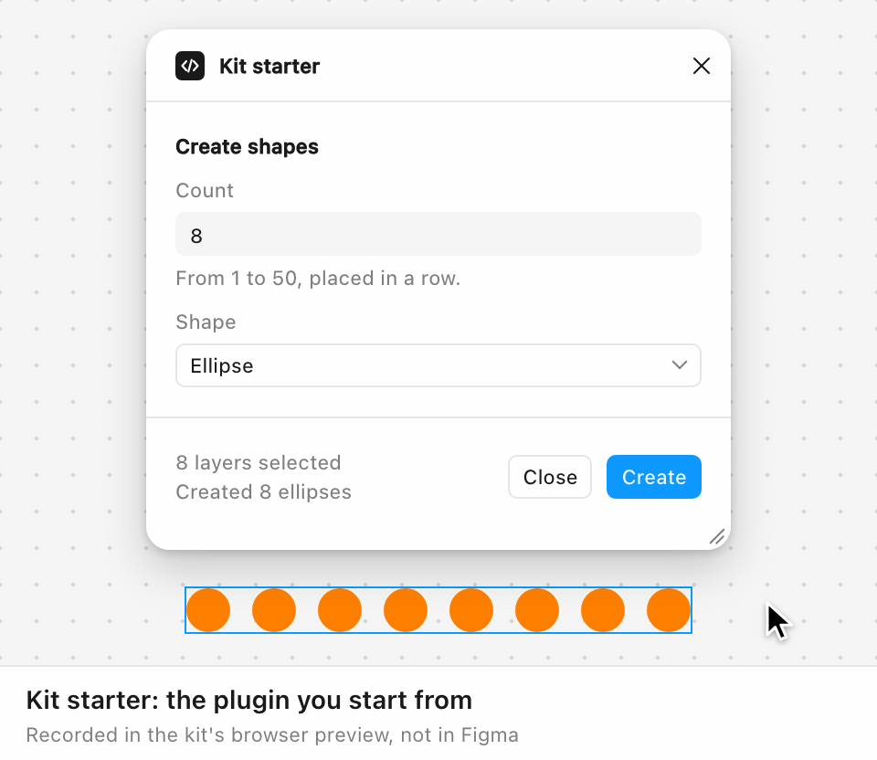
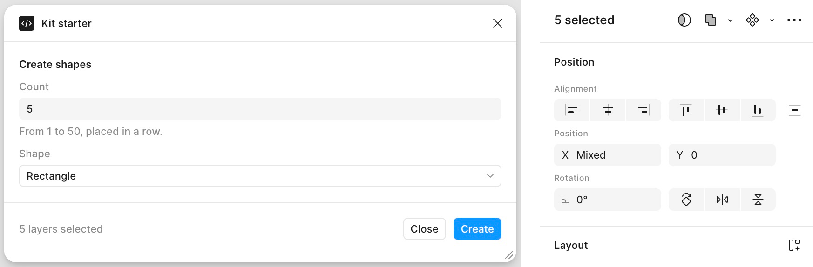
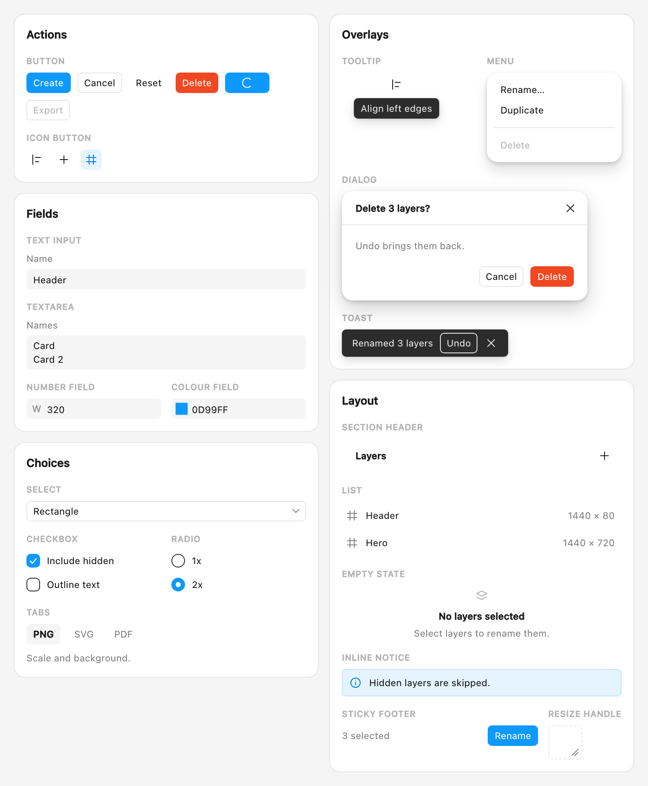
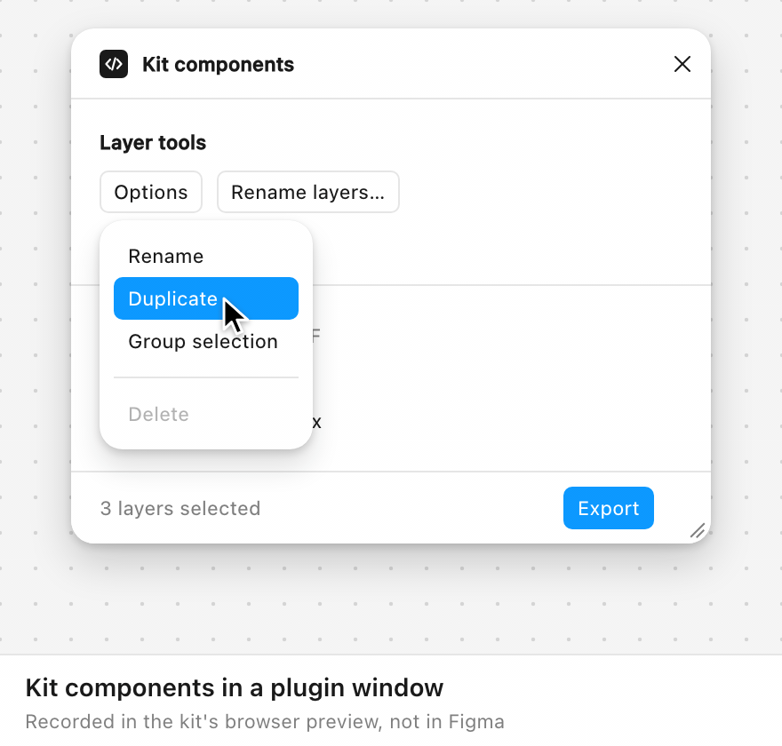
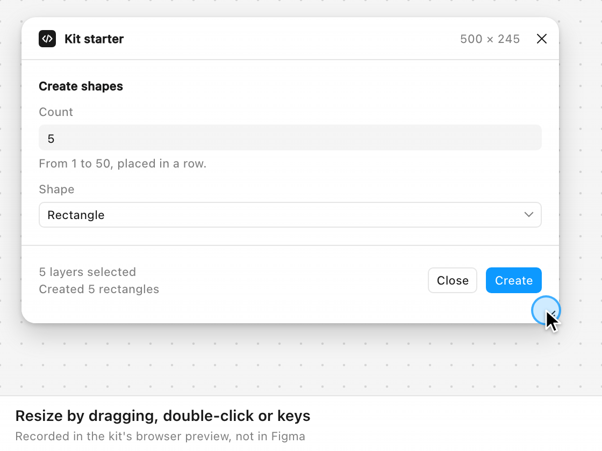

<div align="center">

# Figplug UI Kit

**Build Figma plugins that look and feel like Figma, with Claude Code or Cursor doing the coding.**<br>
Made for designers: plain files, no bundler or framework, and it runs in Figma straight from the folder.

[](https://github.com/alekseikipin/Figplug-ui-kit/actions/workflows/ci.yml) [](LICENSE) [](CHANGELOG.md) [](docs/install.md)

</div>

> [!TIP]
> **Is this for you?** For a quick internal tool, use [Figma's agent](https://help.figma.com/hc/en-us/articles/43028920030743-Generate-plugins-with-the-Figma-agent). For network access, monetization, FigJam, Dev Mode or full control of the UI, start here.

<div align="center">

<picture>
  <source media="(prefers-color-scheme: dark)" srcset="docs/media/hero-dark.gif">
  
</picture>

<sub>The starter plugin you begin from: replace it with yours. Recorded in the kit's browser preview (<code>preview.html</code>: the real <code>ui.html</code> and <code>code.js</code> against a stand-in for Figma, in Chromium), not in Figma. Staged for the recording: the canvas and its shapes, the live theme switch, and a short delay before the main thread's reply so the spinner shows. Screenshots of the real Figma app are under <a href="#looks-native">Looks native</a>.</sub>

</div>

**Try it:** **Code → Download ZIP** and unzip it, then in the Figma desktop app choose **Plugins → Development → Import plugin from manifest…** and pick `manifest.json` ([step by step](#60-second-start)).

<p align="center"><a href="#looks-native">Looks native</a> · <a href="#60-second-start">Start</a> · <a href="#build-with-your-ai-agent">Build with AI</a> · <a href="#20-components">Components</a> · <a href="#example-plugins">Examples</a> · <a href="#docs">Docs</a></p>

<sub>Not [rsms/figplug](https://github.com/rsms/figplug), the plugin build tool.</sub>

## What you get

- **Looks like Figma.** Figma's own `--figma-color-*` tokens and 24 px controls, so it matches light, dark and FigJam.
- **Zero build to run.** `manifest.json`, `code.ts` and `ui.html`, with the compiled `code.js` committed. No bundler, no framework.
- **Made for agents.** [`AGENTS.md`](AGENTS.md) and two Claude Code skills give your agent the rules, and `npm run audit` checks what it wrote.
- **A window that behaves.** It fits its content, resizes by grip or keyboard, snaps, and remembers its size per editor.
- **20 components.** CSS classes on plain HTML, from buttons to a modal dialog and toasts.
- **Checks that catch mistakes.** `npm run audit` (19 rules) and `npm run check:ui`, plus unit and browser tests.

## Looks native

The starter's window next to Figma's own Design panel, in Figma, at the same moment and the same scale:

<picture>
  <source media="(prefers-color-scheme: dark)" srcset="docs/img/figma-side-by-side-dark.png">
  
</picture>

<sub>Figma desktop app 126.9.13 (macOS), 2026-10-14, with the five rectangles the starter made still selected: two captures, cropped and set side by side, not edited. This shows your system's theme; the full captures are light (<a href="docs/img/figma-starter-light.png">starter</a>, <a href="docs/img/figma-panel-light.png">panel</a>) and dark (<a href="docs/img/figma-starter-dark.png">starter</a>, <a href="docs/img/figma-panel-dark.png">panel</a>). Dark was reached by switching Figma's theme with the plugin open: it recoloured without a reopen. The account avatar is cropped out of the panel.</sub>

In FigJam the same window turns light with a purple Create button, because FigJam has no dark mode.

## 60-second start

All you need is the **Figma desktop app**: no terminal, no Node, no build.

1. **Code → Download ZIP** on this page and unzip it, or `git clone https://github.com/alekseikipin/Figplug-ui-kit.git`.
2. In Figma, open any file, then from the Figma menu choose **Plugins → Development → Import plugin from manifest…** and pick `manifest.json`.
3. Run **Plugins → Development → Kit starter**. Set a count, press **Create**, drag the corner grip.

Nothing happens, or macOS asks about Documents? See the [import gotchas](docs/install.md#import-gotchas).

## Build with your AI agent

<picture>
  <source media="(max-width: 600px) and (prefers-color-scheme: dark)" srcset="docs/media/agent-narrow.svg#dark">
  <source media="(max-width: 600px)" srcset="docs/media/agent-narrow.svg#light">
  <source media="(prefers-color-scheme: dark)" srcset="docs/media/agent.svg#dark">
  
</picture>

<sub>An illustration, not a screen recording. The commands and their output lines are real, from kit 0.4.0.</sub>

Give Claude Code or Cursor this one prompt, with `<task>` filled in:

```text
Clone https://github.com/alekseikipin/Figplug-ui-kit, read AGENTS.md,
build a plugin that <task> with kit classes only,
then tell me how to import it.
```

For example, the task in the illustration: `<task>` = "renames the selected layers with a prefix, find and replace, and optional numbering, and shows a preview of the new names before I apply them". [`AGENTS.md`](AGENTS.md) gives the agent the rules and the checks to run before it says it is done. Five pinned prompt tasks and every logged run are in [docs/prompts.md](docs/prompts.md): at kit 0.4.0 an agent in a fresh clone passed build, audit and check:ui on all five ([what was seen in Figma](#status)).

## 20 components

<picture>
  <source media="(prefers-color-scheme: dark)" srcset="docs/media/components-sheet-dark.png">
  
</picture>

<sub>The kit's own CSS in Chromium, with the fallback copy of Figma's colours (<code>tokens.figma-fallback.css</code>), not a Figma screenshot.</sub>

| Group | Components |
|---|---|
| Actions | button, icon button |
| Fields | text input, textarea, number field, colour field |
| Choices | select, checkbox, radio, tabs |
| Overlays | tooltip, menu, dialog, toast |
| Layout | list, empty state, inline notice, section header, sticky footer, resize handle |

<picture>
  <source media="(prefers-color-scheme: dark)" srcset="docs/media/components-dark.gif">
  
</picture>

<sub>Recorded in the kit's browser preview, not in Figma: a small plugin made from the kit's own blocks.</sub>

States are attributes (`disabled`, `aria-invalid`, `aria-busy` …), and `npm run preview` shows every component in every state in your browser. The dialog is a native modal, `const choice = await kit.dialog('id')`; a toast is one call, `kit.toast('Renamed 3 layers', { tone: 'success' })`. Markup and do's and don'ts: [docs/components.md](docs/components.md).

## Example plugins

<picture>
  <source media="(prefers-color-scheme: dark)" srcset="docs/media/examples-dark.gif">
  
</picture>

<sub>Recorded in the kit's browser preview, not in Figma, on the preview's stand-in document.</sub>

Five archetypes from one-shot runs, plus the kit tour, the demo the Community listing runs. Each archetype began as the one prompt in a fresh clone and was then reviewed and fixed; its README has the prompt, the agent's diff and what the review changed. The tour was built by hand to show every component and the window at work. Each has its own `manifest.json` to import, and `npm run preview` runs any of them in the browser.

| Example | What it does | Window |
|---|---|---|
| [rename-layers](examples/rename-layers/README.md) | Prefix, find and replace, numbering, with a preview first | `fit-content` |
| [export-selection](examples/export-selection/README.md) | Selected layers as PNG at 1x, 2x or 3x | `resizable` |
| [content-fill](examples/content-fill/README.md) | Names, emails, dates or numbers in selected text | `fixed` |
| [variables-sync](examples/variables-sync/README.md) | The file's colour variables, edited by hex | `resizable` |
| [a11y-contrast](examples/a11y-contrast/README.md) | WCAG contrast of selected text against its background | `fit-content` |
| [kit-tour](examples/kit-tour/README.md) | The kit tour: all 20 components working, the starter's Create demo, and the window refitting to each of three tabs. The [Figplug](https://www.figma.com/community/plugin/1545605168743471916) listing on the Figma Community runs it | `fit-content` |

Delete `examples/` when you start your own plugin: your build and the checks don't depend on it.

## A window that behaves

<picture>
  <source media="(prefers-color-scheme: dark)" srcset="docs/media/window-dark.gif">
  
</picture>

<sub>Recorded in the kit's browser preview, not in Figma.</sub>

- **Three modes**, one line in `code.ts`: `installKitWindow({ mode: 'fit-content' })` (the default: the height follows the content), `'resizable'` or `'fixed'`.
- **A corner grip**: drag it (Escape mid-drag goes back), or double-click to snap to 320, 480 and 640 px.
- **The keyboard too**: Tab to the grip; Left and Right move 8 px (Up and Down too in `resizable` mode), Shift 32 px, Enter snaps, Home returns to the default width, End goes widest. A screen reader hears the new size once.
- **Remembers the size per editor**, in `figma.clientStorage`: only sizes the person chose, and only the width in `fit-content` mode.
- **Steps aside where Figma docks the plugin** (Dev Mode, Buzz): the panel owns the size there.

Details, and what has been checked in Figma: [docs/window-chrome.md](docs/window-chrome.md).

## Checks that catch mistakes

<picture>
  <source media="(max-width: 600px) and (prefers-color-scheme: dark)" srcset="docs/media/audit-narrow.svg#dark">
  <source media="(max-width: 600px)" srcset="docs/media/audit-narrow.svg#light">
  <source media="(prefers-color-scheme: dark)" srcset="docs/media/audit.svg#dark">
  
</picture>

<sub>An illustration with real <code>npm run audit</code> output from kit 0.4.0.</sub>

```sh
npm run build && npm run audit && npm run check:ui
```

- **`npm run build`** compiles `code.ts` to `code.js` with `tsc`, and nothing else.
- **`npm run audit`** runs 19 rules, from tokens-only colours and 24/32 px controls to labels, the manifest's shape and unawaited `*Async` calls. It prints `path:line  rule-id  message` and exits 1 on errors ([every rule and its fix](docs/pitfalls.md#audit-rules)).
- **`npm run check:ui`** type-checks the scripts in `ui.html` against `kit.d.ts`.

`npm run check` adds the unit tests, and `npm run test:e2e` drives the window, the components and the examples in Playwright, with axe in light, dark and FigJam. Node.js 24 and `npm install` are only needed for these, not to run the plugin.

## Your loop

| When | Then |
|---|---|
| `ui.html` changed | Nothing to build: rerun the plugin with **Cmd+Opt+P** (Ctrl+Alt+P). |
| `code.ts` changed | `npm run build`, or keep `npm run watch` running (start it again after reopening VS Code), then rerun. |
| Something fails | **Plugins → Development → Show/Hide console**, then [docs/loop.md](docs/loop.md). |

Your agent runs `npm run audit && npm run check:ui` before each rerun.

<details>
<summary><b>Import gotchas</b></summary>

- **macOS asks about Documents** (or Desktop, Downloads): allow it, or Figma can't read the folder.
- **The file picker does nothing**: choose the item from the Figma menu with a file open, not from the canvas's right-click menu; restart the app if it still does nothing.
- **Plugins, not Widgets**: the Widgets menu has a look-alike *Import widget from manifest…* item.
- **Change the example `id`** in `manifest.json` before you build on it. `figma.clientStorage` is keyed by it, so every copy that keeps `kit-starter-change-this-id` shares one store.

All of them, with fixes: [docs/install.md](docs/install.md#import-gotchas).

</details>

## Limits, plainly

- **Dropdowns are the native `<select>`.** The open list is your operating system's popup, not Figma's menu.
- **FigJam is light only**, with a purple brand colour; FigJam has no dark mode.
- **Slides has no variables** (nor components or styles), so plugins built on them don't work there.
- **Inter, or system-ui.** The kit names Inter first and loads no font; where the plugin window lacks Inter, text falls back to the system font ([opt-in Inter](docs/tokens.md#kit-tokens)).
- **Dev Mode needs a second manifest**, and Dev Mode and Buzz dock the plugin in a panel with no resize grip ([surfaces](docs/surfaces.md)).
- **Measured on macOS only**, in Figma desktop 126.9.13. Anything not yet seen in a real Figma client is marked UNVERIFIED in the docs.

## How it works

<picture>
  <source media="(max-width: 600px) and (prefers-color-scheme: dark)" srcset="docs/media/how-it-works-narrow.svg#dark">
  <source media="(max-width: 600px)" srcset="docs/media/how-it-works-narrow.svg#light">
  <source media="(prefers-color-scheme: dark)" srcset="docs/media/how-it-works.svg#dark">
  
</picture>

<sub>A diagram; the sizes are the starter's in the kit's browser preview.</sub>

- **Two threads, only messages between them.** `code.ts` runs on Figma's main thread (the `figma` API, no DOM); `ui.html` runs in an iframe (the DOM, no `figma`). The kit's own messages are `kit:*`; yours get any other `type` ([messages](docs/messages.md)).
- **The window is a handshake.** `installKitWindow()` opens the window hidden; the runtime in `ui.html` measures `[data-kit-root]` and asks for a size; `code.ts` clamps it, applies it, shows the window and saves only what the person chose.
- **Marked blocks you never edit.** Three `data-kit` blocks in `ui.html` and the `kit:window` block in `code.ts` stay as released, so upgrading is a re-paste ([upgrade](docs/upgrade.md)). Already have a plugin? [Paste the blocks into it](docs/messages.md#adding-the-kit-to-an-existing-plugin).

## Docs

The pages in [docs/](docs/index.md) are the canonical version; this README links into them.

- **Start:** [Install](docs/install.md) · [Your loop](docs/loop.md) · [First plugin](docs/first-plugin.md) · [Prompts](docs/prompts.md)
- **Build:** [Components](docs/components.md) · [Tokens](docs/tokens.md) · [Window chrome](docs/window-chrome.md) · [Messages](docs/messages.md) · [Surfaces](docs/surfaces.md) · [Accessibility](docs/accessibility.md) · [Pitfalls](docs/pitfalls.md) · [UI3 mapping](docs/ui3-mapping.md)
- **Ship:** [Publishing](docs/publishing.md) · [Upgrade](docs/upgrade.md) · [Stability](docs/stability.md) · [Community listing](docs/community-listing.md)
- **Project:** [Release checklist](docs/release-checklist.md) · [Roadmap status](docs/roadmap-status.md) · [PropsKit](docs/propskit.md) · [Changelog](CHANGELOG.md)
- **Figma's own docs:** [plugin quickstart](https://developers.figma.com/docs/plugins/plugin-quickstart-guide/) · [CSS variables](https://developers.figma.com/docs/plugins/css-variables/)

## Status

**Kit 0.4.0, before 1.0, not yet released** (the [changelog](CHANGELOG.md) dates it when its tag is pushed). Since 0.2.0 nothing public has been renamed or removed ([stability](docs/stability.md)). Locally, `npm run check` and the browser tests pass; CI runs on every push (badge above). Item by item: [release checklist](docs/release-checklist.md) and [roadmap status](docs/roadmap-status.md).

- **Seen in the Figma desktop app** (126.9.13, macOS, 2026-10-14): the starter imported from the folder and ran in Design, FigJam, Slides and Buzz, and matched Figma's own panel in both Design themes; in Design it resized from the keyboard and reopened at its width. Each of the five archetype plugins ran its main action once in Design (dark), through the starter's manifest. Of the five prompt tasks, the agent's plugins for three were seen doing their task in Figma.
- **Still pending, among others:** the kit tour, which has not run in Figma yet; pointer drags; the menu, tooltip, dialog and toast inside Figma; a Figma re-run of the fix for a window shown before it fitted (the starter in FigJam and Slides, and the examples' blank first second in Design); each example's own manifest, its light theme and its other editors; the native colour picker, screen readers and forced colours; the browser client; Windows; and the test with two first-time designers. The full list is in the [release checklist](docs/release-checklist.md#manual-surface-matrix).

## Contributing

Open an issue first ([bug form](https://github.com/alekseikipin/Figplug-ui-kit/issues/new/choose): it asks for the editor, the theme and the kit header from `ui.html`), then read [CONTRIBUTING.md](CONTRIBUTING.md): hand-editable files and only `tsc`, tokens-only colours, at most 20 components, and every rule checkable.

## Licence

MIT: see [LICENSE](LICENSE). Figma is a trademark of Figma, Inc.; this kit is not affiliated with Figma.
