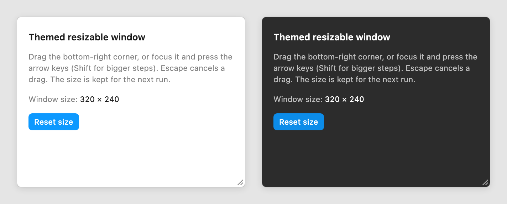

# figma/plugin-samples PR: themed resizable window

Prepared 2026-10-13. **Not opened.** Opening it is the owner's outward action. PLAN.md §6 Phase 3, item 2 is done when the PR is "opened, response recorded".

What is in this folder:

| Path | Goes into the PR as |
|---|---|
| [themed-resizable-window/](themed-resizable-window/) | `themed-resizable-window/` at the repo root (`manifest.json`, `code.ts`, `ui.html`, `tsconfig.json`, `package.json`, `README.md`; `code.js` is rebuilt there and gitignored) |
| [_screenshots/themed-resizable-window.png](_screenshots/themed-resizable-window.png) | `_screenshots/themed-resizable-window.png`, used by the sample's README and the root README entry |
| [pr-screenshots/keyboard-focus-dark.png](pr-screenshots/keyboard-focus-dark.png) | an image dragged into the PR description (not committed) |

The sample stands alone. It has no kit names, marked blocks or kit files, and it follows the samples repo's conventions: the manifest fields every sample uses, `"target": "es6"` and `"lib": ["es6"]` in `tsconfig.json`, a per-sample `package.json` with a `build` script like `metacards/` and `vote-tally/`, double quotes, `figma.ui.onmessage`, and a short README in the pattern of `annotations/`. There is one deliberate difference. Its `tsconfig.json` names `"types": ["@figma/plugin-typings"]` and doesn't rely on `typeRoots`, because TypeScript 6 no longer loads type packages unless `types` lists them. It compiles the same way under the repo's TypeScript 5 and under a global TypeScript 6 install.

## Title

```
Add a themed, resizable window sample (themeColors, figma.ui.resize, clientStorage)
```

## Body

Paste everything inside the fence. Then drag in the two images where the body says so.

```markdown
## What

A new sample, `themed-resizable-window/`: a plugin window that

- follows the Figma theme with `figma.showUI(__html__, { themeColors: true })` and only the `--figma-color-*` CSS variables (no colour values in the code), so it works in light, dark and FigJam, and keeps up when the theme changes while it is open;
- resizes from a bottom-right handle that uses pointer capture, cancels with Escape, and also works from the keyboard (arrow keys, Shift for bigger steps; the new size is announced to screen readers);
- calls `figma.ui.resize` from the main code, with the requested size validated, clamped and rounded there;
- saves the size with `figma.clientStorage` and reopens at that size on the next run ("Reset size" clears it).

`code.ts` and `ui.html` together are about 200 lines. Nothing is needed beyond `@figma/plugin-typings` and TypeScript. The PR also adds a root README entry under "Examples with a plugin UI" and a screenshot in `_screenshots/`.

## Why

No sample covers this today:

- No sample calls `figma.ui.resize`. `resizer/` resizes the selected layer, not the plugin window.
- No sample uses `figma.clientStorage`.
- Only four samples pass `themeColors: true`: `esbuild-react`, `webpack-react`, `icon-drag-and-drop-hosted` and `variables-import-export`. Two of those need a bundler. `barchart`, `piechart` and `icon-drag-and-drop` still load the 2018 `figma-extension-api-0.0.1.css` stylesheet, which doesn't follow the theme.

The docs recommend `themeColors` and document `figma.ui.resize`, but a resizable window has a few traps that a copyable sample avoids:

- Pointer capture keeps the drag alive when the pointer leaves the handle.
- Only a minimum size (70 × 0) is documented, so the sample clamps the size itself.
- It saves once per drag, not on every pointer move.
- Bad saved data is validated before it reaches `showUI`.

## How to test

1. `cd themed-resizable-window && npm install && npm run build`
2. In the Figma desktop app: Plugins > Development > Import plugin from manifest..., pick `themed-resizable-window/manifest.json`, and run it.
3. Drag the bottom-right corner. The window follows the pointer. Rerun the plugin, and it opens at the new size.
4. Start a drag and press Escape before you release. The window goes back to where the drag started, and that size isn't saved.
5. Tab to the corner and press the arrow keys (Shift+arrow moves 32 px). The size changes and is saved.
6. Switch Figma between the light and dark themes while the plugin is open, and the colours follow. Run it in FigJam to see FigJam's palette.
7. Click "Reset size". The window goes back to 320 × 240 and the saved size is cleared.

## Screenshots

[drag in _screenshots/themed-resizable-window.png: light and dark]
[drag in keyboard-focus-dark.png: the handle focused from the keyboard, after Shift+arrow resizing]
```

The two images are renders of `ui.html` in a local test host that uses Figma's light and dark token values. They are not captures from Figma. The repo's other screenshots are real Figma captures, so take your own in step 1 of the checklist and use those instead if you can. Keep the same file name and a similar size (about 1400 × 600 px).

## Checklist (owner)

1. **Try it in Figma from the kit first.** `code.js` is committed, so no build is needed. In the desktop app, import `contrib/plugin-samples/themed-resizable-window/manifest.json` and go through "How to test" steps 2-7. Take a light and a dark screenshot if you want real ones.
2. **Fork** `figma/plugin-samples` to your account on GitHub. Then:
   ```sh
   git clone https://github.com/<you>/plugin-samples.git
   cd plugin-samples
   git checkout -b add-themed-resizable-window
   ```
3. **Copy the folder to the repo root** as `themed-resizable-window/`, and copy the screenshot:
   ```sh
   KIT=/path/to/Figplug-ui-kit
   cp -R "$KIT/contrib/plugin-samples/themed-resizable-window" ./themed-resizable-window
   cp "$KIT/contrib/plugin-samples/_screenshots/themed-resizable-window.png" _screenshots/
   rm themed-resizable-window/code.js
   printf 'code.js\n' > themed-resizable-window/.gitignore
   ```
   The `.gitignore` matches the other TypeScript samples, which don't commit `code.js`. The kit keeps `code.js` in `contrib/` only so the folder imports without a build.
4. **Build it there:** `cd themed-resizable-window && npm install && npm run build && cd ..`. It must print no errors and create `code.js`. Commit the generated `package-lock.json`, as `metacards/` and `vote-tally/` do. Optionally check it against the root's shared typings as well: `npm install && npx tsc -p themed-resizable-window` at the repo root.
5. **Add the root README entry.** In `README.md`, put it under "## Examples with a plugin UI", after the "PNG Crop" entry, in the same format as its neighbours:
   ```markdown
   ### Themed Resizable Window

   

   A window that follows the Figma theme, resizes from its corner with the mouse or the keyboard, and remembers its size.

   This demonstrates:

   - styling a plugin UI with `themeColors` and the `--figma-color-*` CSS variables,
   - resizing the plugin window with `figma.ui.resize`, and
   - saving and restoring the size with `figma.clientStorage`.

   [Check out the source code.](themed-resizable-window/)
   ```
6. **Re-import the copy** from the fork (`themed-resizable-window/manifest.json`) and run it once. This proves the built `code.js` works.
7. **Commit, push and open the PR** against `figma/plugin-samples` `main`, using the title and body above:
   ```sh
   git add themed-resizable-window _screenshots/themed-resizable-window.png README.md
   git commit -m "Add themed resizable window sample"
   git push -u origin add-themed-resizable-window
   ```
   Then open the PR on GitHub, or run `gh pr create --repo figma/plugin-samples --base main`.
8. **Record it** on the day you open it, in the table in section 2 of `docs/roadmap-status.md`: fill in **Opened** (the date) and **PR URL**, and write "awaiting response" under **Outcome**.

Licence: the repo is MIT (`LICENSE.md`, "Copyright (c) 2021 Figma"), and a PR is contributed under that licence. The sample was written for this PR and copies no kit code. The body doesn't link the kit on purpose: the sample has to stand on its own, and the open starter-link PRs (#192, #193, #194) show that links don't get merged. If you want to mention where the sample came from, one line at the end of the body is enough.

## Odds, and when to record the response

Expect no merge, and probably no reply. Checked through the GitHub API on 2026-10-13:

- The repo has no `CONTRIBUTING.md` and no `.github/` folder. Its last commit was 2026-03-23, a README link fix by Figma staff.
- The last human PR merged was #177 on 2024-12-09, by a Figma collaborator. Since then only dependabot PRs have been merged, the last on 2025-02-11.
- 9 human PRs were opened from 2024-08-14 on, and only #177 was merged. Of the 7 from outside contributors, none was merged: 3 were closed unmerged (#170, #172, and #180, a React starter sample), and 4 are still open (#188, #192, #193, #194). Even a staff PR, #184 "Add Component Annotations Example", has been open since 2025-02-02.
- Outside PRs that add or rework a sample stay open or get closed without a merge: #47, a Svelte sample (open since 2021-05); #180, a React starter (closed 2025-03-16); and #13, a rework of the React example (open since 2020-05).

Sources: <https://api.github.com/repos/figma/plugin-samples/pulls?state=all&per_page=100> (pages 1-2, 142 PRs) and <https://api.github.com/repos/figma/plugin-samples/commits>.

Fill in the table in section 2 of `docs/roadmap-status.md` (columns Opened, PR URL, Response, Outcome) twice:

1. **On the day you open the PR:** Opened, PR URL, and "awaiting response" under Outcome.
2. **30 days later:** under Response, put the date, who replied and what they said; under Outcome, put merged, closed or open. If nobody replied, write "no response after 30 days". For example, if you open it on 2026-10-20, check on 2026-11-19. After that, look at it again at each monthly maintenance. Don't ping more than once.

The 30-day entry is what closes PLAN §6 item 2: the PR was opened and a response (or none) is recorded. Nothing else in the plan depends on a merge.
