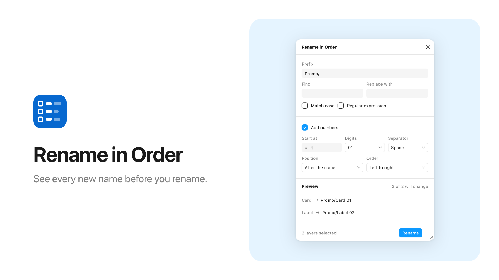
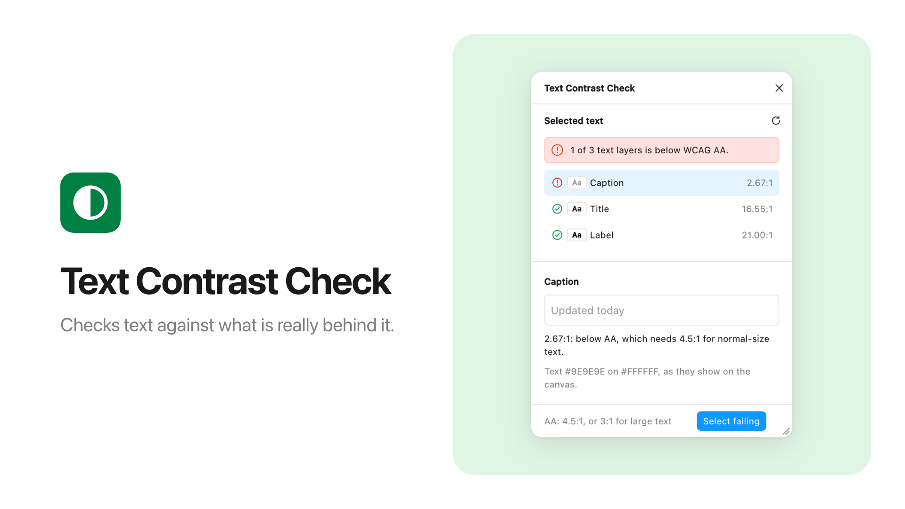

# Community listing

The copy for the Figma Community listings and the owner's steps to publish them: the kit's own listing (**Figplug**, which runs the kit tour), and the two archetype plugins PLAN.md section 6 asks for, **Rename in Order** and **Text Contrast Check**. Publishing is an owner action: nothing on this page has been submitted yet ([release-checklist.md](release-checklist.md#outward-actions-waiting-for-the-owner)). The general checklist behind every field is [publishing.md](publishing.md).

- [The kit's own listing](#the-kits-own-listing): name, tagline, description, the version note, fields, carousel media, republish steps.
- [The two archetypes](#the-two-archetypes-built-with-figplug): listing copy, data security answers, manifest changes, images and the owner checklist.

## The kit's own listing

The kit's own listing is **Figplug**, [plugin 1545605168743471916](https://www.figma.com/community/plugin/1545605168743471916), published by the owner in 2025 from the kit's 2025 version (a theme-aware plugin window with a resize grip, size memory and snap widths; the 2025 files on GitHub are at commit `e0d1acf`). Its next version runs the **kit tour** ([examples/kit-tour](../examples/kit-tour/README.md)): a real plugin window that shows every part of the kit working, so people can try the UI before they clone the repo. The value is in the repo; the listing points there. This is an update of the existing plugin, not a new one: the id, the name, the illustrated icon and cover, and the support contact stay as they are.

### Name

- **Name:** Figplug (the name the listing already has; the owner keeps it)
- **Fallback name:** TBD (fill in here once it is reserved; then use it in the README's brand line too)

Figma's trademark guidelines ask not to put "Fig" (part of Figma's name) in a product name, so "Figplug" may have to change; the fallback name is Figma-free for that case. Describe the kit with compatibility wording ("for Figma plugins", "works with Figma"), never as "a Figma UI kit". ([Using the Figma brand](https://www.figma.com/using-the-figma-brand/))

### Tagline

> Try 20 plugin UI parts that look like Figma's own, then build your plugin with an AI agent.

### Description

Paste as is, then make the lead-in of each paragraph bold, link the GitHub address and turn the "Good to know" lines into a bulleted list (Figma's description editor keeps only plain text when you paste). Every claim is from [the tour's README](../examples/kit-tour/README.md), its tests, and the kit's docs.

> **Try every part of Figplug UI Kit here.** The kit is free starter code for Figma plugins that look like Figma's panels. Explore it in the plugin's three tabs, then build your own plugin with an AI agent.
>
> **Components.** All 20 parts: buttons, text and number fields, a colour field, a dropdown, checkboxes, tabs, a menu, a dialog, notifications, a list and more.
>
> **Create.** Pick a number and a shape, press Create, and the plugin adds the shapes to your page and selects them. This is the only tab that changes your file.
>
> **Window.** Switch tabs and watch the window fit its content. Drag the bottom-right corner to change the width. The plugin remembers it.
>
> **Get the files:** https://github.com/alekseikipin/Figplug-ui-kit. The page has a prompt to paste into an AI agent: describe your plugin in one sentence, and the agent builds it.
>
> **Good to know**
> - Dropdown lists open in your computer's style, not Figma's.
> - FigJam has no dark mode, so the plugin is always light there.
> - Figma gives plugins the Inter font in fixed weights only, so text can look a little bolder than Figma's panels.
> - Works in Figma Design, FigJam, Slides and Buzz, but not in Dev Mode.
>
> **No internet access.** The plugin sends nothing anywhere and collects no data. It only remembers the window width you chose, on your computer.
>
> MIT licence. Not made by or affiliated with Figma.

The description keeps the kit's name ("Figplug UI Kit") because the files on GitHub carry it. If the name has to change ([Name](#name)), change it here too.

### What's new in version 3

For the release notes field of **Publish new version** (the listing's third version, replacing the 2025 one). Paste as is:

> Version 3 lets you try all 20 parts of Figplug UI Kit, create shapes, and watch the window fit each tab. It now works in Figma Design, FigJam, Slides and Buzz. Get the files: https://github.com/alekseikipin/Figplug-ui-kit

### Listing fields

| Field | Value |
|---|---|
| Category | Software development (or Design tools) |
| Network access label | No access to network (from `"networkAccess": { "allowedDomains": ["none"] }`) |
| Support contact | Keep the support email already on the listing (the owner's). Don't replace it with the GitHub issues link; the description links the repo. |
| Icon | Keep the owner's illustrated icon already on the listing. |
| Thumbnail (cover) | Keep the owner's illustrated cover already on the listing. |
| Carousel | Replace the 2025 demo video with new media captured in the real Figma desktop app ([carousel media](#carousel-media)). |
| Data security form | Optional. Answers: no backend, no third-party requests, no authentication, no Figma data stored off the device (only the window width, in `figma.clientStorage`). Review can take up to two weeks. The [archetypes' answers](#data-security-answers-both) fit this plugin too. |
| Privacy policy | Not needed while the plugin processes no user data; required if a future version does. |

Sources: [Publish classic plugins to the Figma Community](https://help.figma.com/hc/en-us/articles/360042293394), [Manage classic plugins as a developer](https://help.figma.com/hc/en-us/articles/360042293714), [Plugin and widget review guidelines](https://help.figma.com/hc/en-us/articles/360039958914).

### Carousel media

Captured in the Figma desktop app from the publish folder's plugin (step 3 below), never in the browser preview: the guidelines ask that screenshots show the plugin as it is, and the preview's colours and fonts are a stand-in. Up to nine images or videos; 1920 × 1080 px.

Made on 2026-10-14 in Figma desktop 126.9.13 (macOS, Figma in its dark theme), in scratch files, and kept in [`docs/listing/kit-tour/`](listing/kit-tour/). Upload them after the illustrated cover, in this order:

1. **[`figplug-v3-tour.mp4`](listing/kit-tour/figplug-v3-tour.mp4), 17 s, no sound.** Real window captures, about 9 a second, played back in real time with still stretches cut to 1.6 s. The tour opens on Components. It switches to Create, where Create adds five rectangles on the canvas behind the window. It moves to Window, adds a line, which grows the window, and removes it. It ends back on Components with a toast. There is no pointer: the clicks came from an automation tool.
2. **[`figplug-v3-1-components.jpg`](listing/kit-tour/figplug-v3-1-components.jpg):** the Components tab (buttons and overlays), Figma Design.
3. **[`figplug-v3-2-overlays.jpg`](listing/kit-tour/figplug-v3-2-overlays.jpg):** the Actions menu open, the Rename frame dialog over the dimmed window, and a toast with Undo.
4. **[`figplug-v3-3-create.jpg`](listing/kit-tour/figplug-v3-3-create.jpg):** five rectangles made and selected, with Figma's own Design panel beside the window.
5. **[`figplug-v3-4-window.jpg`](listing/kit-tour/figplug-v3-4-window.jpg):** the Window tab, with the modes, the live size and the keys of the resize handle.
6. **[`figplug-v3-5-editors.jpg`](listing/kit-tour/figplug-v3-5-editors.jpg):** the top of the window in Figma Design (dark), FigJam (light, purple) and Slides (dark, orange).

The images frame crops of the captures on the cover's cream paper, with a title in the cover's lettering. Nothing inside a plugin window was edited. Every crop stays below Figma's tab bar and file-name row, so no other file names and no avatar show. The light theme in Figma Design was not captured, so as not to switch the owner's Figma theme. The raw captures and the script that frames them stay outside the repo, because the captures show the owner's other files.

### Republish steps (owner action)

The listing already exists, so this publishes a new version of plugin 1545605168743471916, not a new plugin. Figma links a version to a plugin by the `id` in the manifest you publish from, so the publish folder's manifest carries that id; the repo's own manifests never do.

1. **Prerequisites.** The Figma desktop app (publishing only works there), two-factor authentication on the Figma account that owns the listing, and a commit of `main` that holds `examples/kit-tour` with CI green on GitHub. The tour is not in the local `v0.4.0` tag; note the commit (or the next tag, once there is one) in step 6.
2. **Make the publish folder, outside the repo.** It holds the tour's three runtime files and nothing else:

   ```sh
   mkdir -p ~/figma-publish/figplug
   cp examples/kit-tour/{manifest.json,code.js,ui.html} ~/figma-publish/figplug/
   ```

   In the copy's `manifest.json`, change two fields, and nothing else:

   | Field | Repo value (`examples/kit-tour`) | Publish folder value |
   |---|---|---|
   | `name` | `Kit tour (kit example)` | `Figplug` (the window title and the Plugins menu show it; keep it the same as the listing name) |
   | `id` | `kit-example-kit-tour` | `1545605168743471916`, the published plugin's id |

   `editorType` (`figma`, `figjam`, `slides`, `buzz`), `documentAccess: "dynamic-page"` and `networkAccess` (`"none"`) stay as they are, minus any editor that fails step 3. Check the folder with the repo's audit: `node scripts/audit.mjs ~/figma-publish/figplug` should print "no problems". Never change the repo's `examples/kit-tour/manifest.json` instead: importing the repo must never share an identity or `figma.clientStorage` with the installed Community plugin. For a later update, copy the new `code.js` and `ui.html` over the old ones and keep the folder's `manifest.json`.
3. **Test it in Figma.** Import `~/figma-publish/figplug/manifest.json` (Plugins > Development > Import plugin from manifest...). The title bar and the Plugins menu should read "Figplug". Run it through the tour's rows of the [examples matrix](release-checklist.md#the-examples): Figma Design light and dark, FigJam, Slides and Buzz. If an editor fails, remove it from the folder's `editorType` and from the description's limits before publishing.
4. **Capture the carousel** from that run ([carousel media](#carousel-media)).
5. **Publish the new version.** In the desktop app: Plugins > Manage plugins, the menu next to Figplug > **Publish new version** (the exact labels are not verified here; [publishing.md](publishing.md#submit)). Paste the [version note](#whats-new-in-version-3) into the version notes field. On the listing: replace the tagline and the description with the copy above, keep the illustrated icon and cover, and replace the 2025 demo video in the carousel with the new captures. On the last page, check that the support contact is still the email already on the listing and that the label reads **No access to network**. The listing page itself can also be edited later without a new version (Manage resource > Edit this page).
6. **Record.** Note the date, the commit or tag published, and the outcome in [release-checklist.md](release-checklist.md#outward-actions-waiting-for-the-owner) (action 2). An update to an approved plugin publishes at once, without a new review, although Figma may review a material update again ([publishing.md](publishing.md#review-and-after)).

Review risks to know before submitting: the guidelines ask for no temporary content and an accurate description, and a kit demo may be read as sample content; the description therefore says plainly that the plugin is a tour of starter files and links to the docs. The guidelines also say a plugin whose core function changed substantially should be a new plugin: the 2025 version was a demo of the same kit (its themed, resizable window), and the tour demos that kit again, with more of it, so this reads as an update, but a reviewer may see it otherwise. If a reviewer objects to the name, switch to the fallback name above.

## The two archetypes ("Built with Figplug")

PLAN.md section 6, item 1: publish two archetypes to the Community with "Built with Figplug" in the description; done when both are live. The two are the curated examples [examples/rename-layers](../examples/rename-layers/README.md) and [examples/a11y-contrast](../examples/a11y-contrast/README.md). Everything below is prepared; nothing has been submitted, and the real-Figma runs they need first have not happened either ([owner checklist](#owner-checklist-both-archetypes)). Record the outcome in [roadmap-status.md](roadmap-status.md#1-two-archetypes-on-community).

Rules both listings follow:

- **The name never contains "Figma" or "Fig"** ([Using the Figma brand](https://www.figma.com/using-the-figma-brand/) asks that no product name contain Figma's name or part of it, such as "Fig"). It says what the plugin does. Compatibility wording ("works in Figma Design") goes in the description only.
- **The kit's brand appears once, at the end of the description**, as "Built with Figplug UI Kit — https://github.com/alekseikipin/Figplug-ui-kit", followed by a line saying the plugin is not affiliated with Figma. Not in the name, the tagline, the icon or the cover. "Figplug" itself contains "Fig"; the [name risk](#name) above applies to that line too.
- **Network access: none.** Both manifests declare `"networkAccess": { "allowedDomains": ["none"] }`, so the listing shows **No access to network**. Neither plugin has a backend, an account or telemetry.
- **Support contact:** https://github.com/alekseikipin/Figplug-ui-kit/issues for both.
- **Docs link:** each description points to its example's README on GitHub, which the review guidelines ask for (setup and use). The repo was pushed on 2026-10-14, so those links resolve ([outward actions](release-checklist.md#outward-actions-waiting-for-the-owner)).
- **The general checklist** for any kit plugin, every field of the publish modal and how review works: [publishing.md](publishing.md).

### Rename in Order (examples/rename-layers)

| Field | Value |
|---|---|
| Name | **Rename in Order** |
| Tagline | Prefix, replace and number layers in the order you see them, with a live preview. |
| Category | Design tools (the exact list in the publish modal is not verified here; pick the closest) |
| Editors | Figma Design and Slides (`editorType` `["figma", "slides"]`); confirm both in the real-Figma runs first |
| Network access | None: the label reads **No access to network** |
| Support contact | https://github.com/alekseikipin/Figplug-ui-kit/issues |
| Icon | [docs/listing/rename-layers/icon.png](listing/rename-layers/icon.png), 128 × 128 |
| Thumbnail (cover) | [docs/listing/rename-layers/cover.png](listing/rename-layers/cover.png), 1920 × 1080 |
| Carousel (optional) | [docs/listing/rename-layers/cover-dark.png](listing/rename-layers/cover-dark.png), the same in dark |
| Privacy policy | Not needed: the plugin processes no user data off the device |

#### Description (paste as is)

> **Rename in Order** renames the layers you select. Add a prefix, find and replace (plain text or a regular expression, with or without matching case) and add numbers, and see every new name before anything changes.
>
> **Numbers in the order you see.** Number layers in Layers-panel order, or in the order they sit on the canvas: top to bottom or left to right. Choose where numbering starts, the digits (1, 01, 001), the separator and whether the number goes before or after the name.
>
> **Preview, then rename.** The preview lists each selected layer with its new name, or "No change" (the first 200, then a count of the rest). It follows what you type, the selection, and layers renamed or moved on the canvas. Rename applies exactly the names in the preview, to every selected layer, as one undo step. An invalid regular expression or start number shows an error and disables Rename.
>
> **Limits.**
> - It renames the layers you select, not the layers inside them, and changes nothing but names.
> - A layer renamed or deleted after the preview appeared is skipped. A name that would end up empty keeps its old name.
> - A regular expression that backtracks badly (such as `(a+)+$` on a long name) can freeze the plugin for a while.
> - A prefix on variants in a component set breaks their Property=Value names. The preview shows the result, but doesn't warn.
> - "Top to bottom" sorts by each layer's top edge. For a row of centre-aligned layers of different sizes, use "Left to right".
> - Works in Figma Design and Figma Slides.
>
> **Privacy.** No network access. The plugin reads layer names only to build the preview. It sends nothing anywhere and stores one value on your device: the window size.
>
> **How to use it and the source code:** https://github.com/alekseikipin/Figplug-ui-kit/tree/main/examples/rename-layers
>
> **Support:** https://github.com/alekseikipin/Figplug-ui-kit/issues
>
> Built with Figplug UI Kit — https://github.com/alekseikipin/Figplug-ui-kit
> Not made by, affiliated with or endorsed by Figma. MIT licensed.

Every claim is from the example's [README](../examples/rename-layers/README.md) and its golden tests. If the Slides run fails, remove `"slides"` from the publish folder's `editorType` and "and Figma Slides" from the last limit before publishing.

#### Review risks

- **Overlap with Figma's own Rename layers.** Figma's built-in batch rename (Cmd/Ctrl+R) has match and replace, numbering, regular expressions and a preview ([Rename layers](https://help.figma.com/hc/en-us/articles/360039958934-Rename-Layers), Figma's help article, read through web search on 2026-10-14). The review guidelines say Figma may not approve plugins that recreate Figma functionality, so this is the main rejection risk. The name, the tagline and the description's second paragraph therefore lead with canvas-order numbering: a [Figma forum feature request](https://forum.figma.com/suggest-a-feature-11/ability-to-batch-rename-frames-based-on-their-visual-order-left-to-right-top-to-bottom-43117) says the built-in numbers layers in Layers-panel order only. Whether that is still true in the current app is UNVERIFIED: check it in the desktop app before submitting. Other rename plugins (Rename It, Batch Rename, per third-party write-ups) are in the Community, so the category is not closed, but a rejection is possible. If it is rejected, record the reason and the reviewer's words in [roadmap-status.md](roadmap-status.md#1-two-archetypes-on-community).
- **"Kit example" wording.** The repo's manifest name is "Rename layers (kit example)". The publish folder's manifest must say "Rename in Order", or the window title and Plugins menu won't match the listing.

### Text Contrast Check (examples/a11y-contrast)

| Field | Value |
|---|---|
| Name | **Text Contrast Check** |
| Tagline | Check selected text against what is really behind it, and flag anything below WCAG AA. |
| Category | Design tools, or an accessibility category if the publish modal offers one (the list is not verified here) |
| Editors | Figma Design, FigJam, Slides and Buzz (`editorType` `["figma", "figjam", "slides", "buzz"]`); confirm each in the real-Figma runs first |
| Network access | None: the label reads **No access to network** |
| Support contact | https://github.com/alekseikipin/Figplug-ui-kit/issues |
| Icon | [docs/listing/a11y-contrast/icon.png](listing/a11y-contrast/icon.png), 128 × 128 |
| Thumbnail (cover) | [docs/listing/a11y-contrast/cover.png](listing/a11y-contrast/cover.png), 1920 × 1080 |
| Carousel (optional) | [docs/listing/a11y-contrast/cover-dark.png](listing/a11y-contrast/cover-dark.png), the same in dark |
| Privacy policy | Not needed: the plugin processes no user data off the device |

#### Description (paste as is)

> **Text Contrast Check** measures the contrast between each selected text layer and what is painted behind it on the canvas, and flags anything below WCAG 2 AA: 4.5:1, or 3:1 for large text (24px, or 18.67px bold). Select text layers, or a frame, group or component that holds some.
>
> **The real backdrop, not a colour pair.** You don't pick two colours. The plugin works out what is behind the text from the layers under it: fills from the bottom up, frame and group opacity, clipping, masks, rounded corners, gradients and Display P3 colours. It samples fifteen points over each layer's glyphs and reports the lowest ratio. A layer with several text styles reports its worst. Text that another layer covers, or that is hidden or clipped, is reported as not visible rather than failing.
>
> **Find and fix.** Results update when the selection changes and after edits. A summary says how many layers fall below AA. Click a row to select that layer and scroll to it. **Select failing** selects every layer below AA. The details show the text and backdrop colours as they appear on the canvas.
>
> **Limits.**
> - Strokes and effects (shadows, blurs) are ignored, blend modes count as Normal, and vectors, stars, polygons and boolean shapes count as their bounding box. Each result says when one of these applied.
> - Text on images, videos, shader fills, embeds and widgets can't be measured; it is marked "check by eye".
> - Fifteen points per layer can miss a backdrop shape smaller than the gaps between them.
> - At most 250 text layers per check.
> - In FigJam, text on stickies and shapes is not a text layer and is not checked.
> - It never changes your file: it only selects layers and scrolls the canvas.
> - Works in Figma Design, FigJam, Figma Slides and Figma Buzz.
>
> **Privacy.** No network access. The plugin reads colours and text layers only to measure them. It sends nothing anywhere and stores one value on your device: the window size.
>
> **How to use it and the source code:** https://github.com/alekseikipin/Figplug-ui-kit/tree/main/examples/a11y-contrast
>
> **Support:** https://github.com/alekseikipin/Figplug-ui-kit/issues
>
> Built with Figplug UI Kit — https://github.com/alekseikipin/Figplug-ui-kit
> Not made by, affiliated with or endorsed by Figma. MIT licensed.

Every claim is from the example's [README](../examples/a11y-contrast/README.md) and its golden tests. If an editor fails in the real-Figma runs, remove it from the publish folder's `editorType` and from the last limit before publishing.

#### Review risks

- **A crowded category.** Stark, A11y - Color Contrast Checker, Able and others already check contrast. That breaks no rule ("one listing per function" applies to your own listings), but the tagline and the second paragraph say what is different: the backdrop is worked out from the canvas, so nobody picks colours by hand.
- **"Kit example" wording.** The repo's manifest name is "Contrast check (kit example)". The publish folder's manifest must say "Text Contrast Check".
- **Measured on a stand-in, run once in Figma.** The ratios are pinned by golden tests in `node:vm` against stub scenes. On 2026-10-14 the plugin ran once in Figma Design (dark, Figma desktop 126.9.13) through the starter's manifest and flagged `#B8B8B8` on white at 1.99:1 and black at 21:1, as expected; its own manifest, the light theme, its other editors, Select failing and row clicks have not been run ([release-checklist.md](release-checklist.md#the-examples)). Run it on real files before submitting. A wrong ratio in an accessibility tool costs more trust than a missing feature.

### Data security answers (both)

The Data security page is optional; Figma reviews the answers (up to two weeks) and shows them to signed-in people on the listing. Its exact questions are not verified here (the form is in open beta); these answers cover the five topics Figma lists. They are the same for both plugins.

| Topic | Answer |
|---|---|
| Backend hosting | None. The plugin runs entirely inside Figma; there is no server. |
| Third-party requests | None. The manifest allows no domains (`"allowedDomains": ["none"]`), and the plugin loads no fonts, scripts or images from the web. |
| Authentication | None. No accounts, no sign-in, no API keys. |
| Data storage | Nothing leaves the device. Layer names, text and colours are read in memory, only while the plugin runs. One value is stored on the device, in Figma's plugin storage (`figma.clientStorage`): the window size the person chose. Neither plugin writes data of its own into the file (Rename in Order changes layer names, which is its job). |
| Updates | Published from the Figma desktop app by the owner. The source and every change are public at https://github.com/alekseikipin/Figplug-ui-kit (CHANGELOG.md). |

### Manifest changes before publishing

Publish each archetype from a **publish folder** outside the repo, never from `examples/<name>/` itself. The repo's manifests keep their placeholder ids (`kit-example-rename-layers`, `kit-example-a11y-contrast`), so people who import the repo never share identity or `figma.clientStorage` with the published plugins.

**The real id.** Figma assigns plugin ids. Plugins > Development > New plugin… writes a template folder whose `manifest.json` holds a fresh numeric id, and registers that folder as a development plugin; the publish flow can also assign one ([publishing.md](publishing.md#the-plugin-id)). The route with the fewest unknowns is to let New plugin… make the publish folder, so the folder Figma knows is the folder you publish:

1. In the Figma desktop app: Plugins > Development > New plugin…, any template, named with the listing name, and **Save as** `~/figma-publish/rename-in-order` (and again as `~/figma-publish/text-contrast-check`). Copy the `id` from the `manifest.json` it wrote.
2. Copy the example's three files over the template's, from the repo at the release being published:

   ```sh
   cp examples/rename-layers/{manifest.json,code.js,ui.html} ~/figma-publish/rename-in-order/
   cp examples/a11y-contrast/{manifest.json,code.js,ui.html} ~/figma-publish/text-contrast-check/
   ```

   The template's other files (its `code.ts`, `package.json` and so on) are not used: the manifest names only `code.js` and `ui.html`. Delete them to keep the folder clear.
3. In each copied `manifest.json`, change two fields, and nothing else:

   | Field | Repo value | Publish folder value |
   |---|---|---|
   | `name` | `Rename layers (kit example)` · `Contrast check (kit example)` | `Rename in Order` · `Text Contrast Check` (the window title and the Plugins menu show it; keep it the same as the listing name) |
   | `id` | `kit-example-rename-layers` · `kit-example-a11y-contrast` | The id from step 1. Never a kit placeholder. |

   `editorType`, `documentAccess: "dynamic-page"` and `networkAccess` stay as they are, minus any editor that failed its real-Figma run.
4. Check the folder with the repo's audit, which takes any plugin folder: `node scripts/audit.mjs ~/figma-publish/rename-in-order` should print "no problems".

How a publish-time id reaches a manifest is UNVERIFIED; if the publish flow shows an id other than the one in the manifest, put that one in the manifest. Write each id in the table below once published: every update must come from a manifest with that id, and changing it later orphans what people saved in `figma.clientStorage`.

| Plugin | Publish folder | Figma id |
|---|---|---|
| Rename in Order | `~/figma-publish/rename-in-order` | pending |
| Text Contrast Check | `~/figma-publish/text-contrast-check` | pending |

For an update, copy the new `code.js` and `ui.html` into the same folder, keep its `manifest.json`, and publish a new version ([publishing.md](publishing.md#the-plugin-id)).

### Listing images

| File | Size | What it shows |
|---|---|---|
| `docs/listing/<name>/icon.png` | 128 × 128 | A white glyph on a tile in a Figma token colour, full bleed: three Layers-panel rows sharing a prefix on `--figma-color-bg-brand-secondary` (5.4:1 against the glyph) for Rename in Order, the half-filled contrast circle on `--figma-color-bg-success-secondary` (5.0:1) for Text Contrast Check. Whether Figma rounds the corners where it shows icons is UNVERIFIED; full bleed works either way. No Figma logo. |
| `docs/listing/<name>/cover.png` | 1920 × 1080 | The icon, the name and a one-line value statement on the left; the plugin's window on a tinted stage on the right, light theme. |
| `docs/listing/<name>/cover-dark.png` | 1920 × 1080 | The same in the dark theme, for the carousel. |

 

**The covers are rendered in the browser preview, not in Figma.** The window is the real example (its own `code.js` and `ui.html`) running in `preview.html`'s fake host against the stub's sample selection (a card with a title and a light grey caption, and a label), with the listing name in the preview's title bar and the size readout hidden. Rename in Order has "Promo/" as prefix and two-digit numbering left to right; Text Contrast Check shows its own result for the sample. The colours are the preview's fallback palette, not Figma's injected values, and the type is the machine's: Inter if installed, else the system font (the committed images use the macOS system font). The guidelines ask that screenshots show the plugin as it is. These do, as far as a browser render can; Figma captures in light and dark would be better, once the real-Figma runs are done ([publishing.md](publishing.md#the-checklist)).

**Regenerate** after a UI change (the spec is skipped unless asked, and fails if the name or the statement no longer fits on one line):

```sh
UPDATE_LISTING=1 npx playwright test e2e/listing-assets.spec.mjs
```

Then look at every image before you upload it. The names, statements, tile colours and window setup live at the top of [e2e/listing-assets.spec.mjs](../e2e/listing-assets.spec.mjs); keep them identical to this page.

### Owner checklist (both archetypes)

None of these steps has been done. Do them for each plugin; the order matters.

1. **Before you start.** The Figma desktop app on macOS or Windows (publishing works only there). Two-factor authentication on the Figma account that will publish. The repo is on GitHub (pushed on 2026-10-14), so the description's links resolve ([outward actions](release-checklist.md#outward-actions-waiting-for-the-owner)).
2. **Run the example in the real Figma app.** Import `examples/<name>/manifest.json` (Plugins > Development > Import plugin from manifest…) and fill its rows in the [surface matrix](release-checklist.md#the-examples), every editor its `editorType` lists. Drop an editor that fails, from the publish folder and from the description. For Rename in Order, also check what Figma's own Rename layers does today ([review risks](#review-risks)).
3. **Check the names.** Search the Community for "Rename in Order" and "Text Contrast Check". Pick another name, without "Figma" or "Fig", if one is taken, and change it here, in the spec, and in the images (regenerate).
4. **Make the publish folder** with New plugin…, copy the example's files in, and change `name` and `id` in its `manifest.json` ([manifest changes](#manifest-changes-before-publishing)). Run the audit on it.
5. **Run the publish folder's plugin once** from Plugins > Development: the title bar and the Plugins menu should show the listing name, and the plugin should do its job as in step 2.
6. **Publish.** In any file: Figma menu > Plugins > Manage plugins, the menu next to the plugin > **Publish…** ([publishing.md](publishing.md#submit) has every page of the modal):
   - **Describe your resource:** the name, tagline, description (paste the block above as is) and category from this page.
   - **Choose some images:** upload `icon.png` as the icon and `cover.png` as the thumbnail; `cover-dark.png` can go in the carousel.
   - **Data security** (optional, recommended): the [answers above](#data-security-answers-both).
   - **Add the final details:** publish to the Community, the support contact https://github.com/alekseikipin/Figplug-ui-kit/issues, and check that the label reads **No access to network**.
   - **Publish.** The plugin shows an **In review** badge.
7. **Wait for review.** Figma gives no duration; the decision comes by email. Forum reports in 2026 range from two to four or more weeks; plan for 10 days to 6 weeks ([publishing.md](publishing.md#review-and-after)). Updates can be pushed while it is in review.
8. **Record.** The id in the [table above](#manifest-changes-before-publishing); the submission date, the review outcome and the live URL in [roadmap-status.md](roadmap-status.md#1-two-archetypes-on-community). PLAN.md's item is done only when both plugins are live.

Sources for this section: [Publish classic plugins to the Figma Community](https://help.figma.com/hc/en-us/articles/360042293394), [Plugin and widget review guidelines](https://help.figma.com/hc/en-us/articles/360039958914), [Security disclosure](https://help.figma.com/hc/en-us/articles/16354660649495) and [Using the Figma brand](https://www.figma.com/using-the-figma-brand/), as read for [publishing.md](publishing.md#sources) on 2026-10-13; Figma's [Rename layers](https://help.figma.com/hc/en-us/articles/360039958934-Rename-Layers) article, the canvas-order feature request and the other plugins' names through web search on 2026-10-14.
